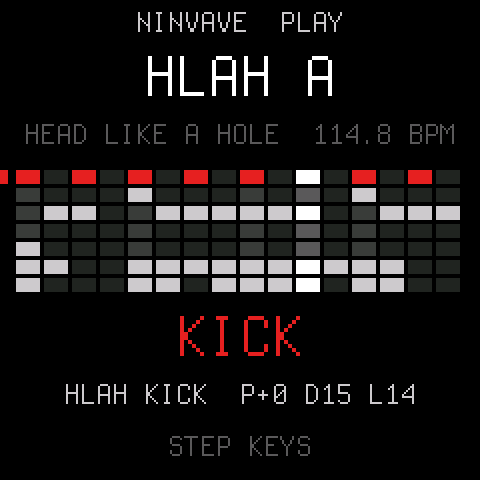

# NINvave

**A groovebox for the M-VAVE FM-1, made of Nine Inch Nails multitracks.**

Seven tracks, one bar of 16 steps, and every sound and preset pattern cut from the songs' own stems: the kick,
snare and bass of *Head Like a Hole*, *Terrible Lie*, *Sanctified* and *The Only Time* (Pretty Hate Machine). Pick a
NIN pattern, mute and rebuild it, swap sounds between the songs, play the bass or the synth live on the keys and
record it.

<p align="center"></p>

> **Status: 0.1 (dev).** Builds and passes the host tests (`tests/run_tests.sh`), plays and records on the host;
> not yet run on an FM-1.

Built on [Dinghy](https://github.com/zvenson/dinghy) (zvenson), which carries the platform of
[Felucca](https://github.com/hugelton/Felucca) (Leo Kuroshita, Hügelton Instruments) and
[SLOOP](https://github.com/isod89/sloop-fm1) (isod89). Dinghy's own README: [docs/DINGHY.md](docs/DINGHY.md).

## Playing it

| | |
| --- | --- |
| **PRESETS** | the pattern: the NIN presets (`HLAH A`, `TLIE B`, ...), then the user slots U1..U8 |
| **SELECT** | the track: KICK SNARE HAT PERC LOOP BASS SYNTH |
| **ALGORITHM** | the tempo (a MIDI clock in takes over) |
| **KNOB1..4** | the track's SOUND (any sound of any song), PITCH (semitones), DECAY, LEVEL |
| **SEQ** | the keys: **STEP** or **PLAY** (the SEQ light is on in STEP) |
| STEP mode | white keys = the 16 steps of the track; black keys 1..7 = choose a track (and hear it), 8 = mute it, 9 = clear it |
| PLAY mode | every key plays the track chromatically (drums too); **OCT- OCT+** shift it |
| **PLAY** / **REC** | start and stop; record: in PLAY mode, while running, what you play lands on the nearest step |
| **FX** | grit on the whole mix: off, CRUSH (half rate, 6 bits), DRIVE |
| **SAVE** | the pattern to its user slot (a NIN preset goes to the first free slot) |
| **MASTER** | the volume |
| MIDI in | notes play the selected track like the keys; a MIDI clock with START / STOP drives the steps |

The LOOP track is one bar of the song, and it follows the tempo (faster tempo, faster loop: tape style).

## The sounds and patterns

`tools/nin_extract.py` makes `firmware/gen/nin_data.h` from the multitracks:

- per song, a kit of 7: a typical clean hit from the kick, snare and cymbal stems (picked by onset, loudness and
  brightness), a hit from the FX stem, a steady note of the bass and of the synths (its pitch found with pYIN, so the
  keys play it in tune), and the song's loudest bar of loops/FX as the LOOP;
- per song, the three bars that repeat most: the kick, snare, hat and perc stems are put on the song's beat grid and
  each hit snaps to its 16th; the bass and synth notes are read step by step (YIN);
- everything as 8-bit mu-law at 22 kHz (loops 11 kHz): 360 KB for 28 sounds, in flash next to the code.

To make it again, or with more songs, put the multitracks under `~/.cache/ninvave/stems` (or pass a folder) and
add the song to `SONGS` in the script:

```sh
python3 -m venv .venv && .venv/bin/pip install Pillow mido python-rtmidi numpy scipy soundfile librosa
.venv/bin/python tools/nin_extract.py            # -> firmware/gen/nin_data.h, build/nin/*.wav to audition
```

Where every sound comes from: [SOURCES.md](SOURCES.md).

## Build, try, install

The same as Dinghy (Linux x86-64 natively, macOS with Docker): [docs/DINGHY.md](docs/DINGHY.md) sets up the JieLi
toolchain and the AC79 SDK.

```sh
tests/run_host.sh tests/scripts/jam.txt          # on the computer: build/host/ninvave.wav and the screens
./build.sh                                       # -> build/ninvave.fwsc, identity FM-1_960
tests/run_tests.sh                               # the host tests
.venv/bin/python tools/fm1_install.py build/ninvave.fwsc   # onto the FM-1 over USB
```

Back to another firmware, or the official one, with the [FM-1 Firmware Hub](https://thefirmwarehub.com) or
M-VAVE's updater. If NINvave will not start: hold **OCT-** while switching on (the USB rescue) and install again.
Installing firmware is at your own risk.

## License

The code: GPL-3.0-only, as Dinghy, Felucca and SLOOP ([LICENSING.md](LICENSING.md)). The sounds in
`firmware/gen/nin_data.h` are excerpts of Nine Inch Nails recordings and stay theirs: see [SOURCES.md](SOURCES.md).
